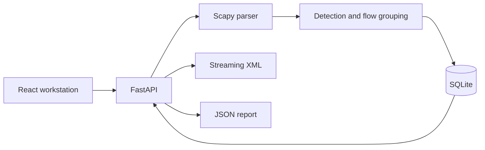
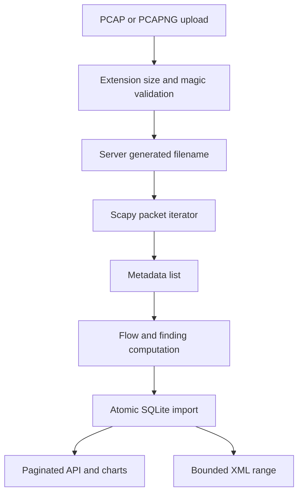
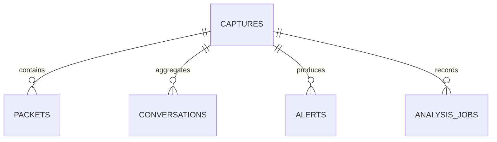

# NetSleuth architecture

## Components and decisions

- `backend/parser.py` reads frames sequentially with Scapy and extracts only metadata. It never saves packet payloads to SQLite.
- `backend/detection.py` evaluates conservative, time windowed heuristics. Thresholds are defined in `DEFAULT_THRESHOLDS` and can be passed to `detect` by callers.
- `backend/db.py` owns versioned schema initialization, transactional import, and bidirectional flow grouping.
- `backend/xml_export.py` incrementally serializes database rows and escapes XML values.
- `backend/main.py` validates uploads and exposes the local FastAPI service.
- `frontend/src` contains the application shell, typed API calls, real charts, and read only investigation views.

## Upload data flow

The current upload endpoint parses inside FastAPI's worker thread. This keeps the event loop responsive but is not a separate background queue. The upload cap defaults to 100 MiB; packet metadata is collected in memory during an import, so this is intended for workstation scale captures.

## Conversation key and direction

The key is `(protocol, sorted(source IP:port, destination IP:port))`. IPv6 endpoints use bracket notation. TCP and UDP ports distinguish services and sessions. ICMP lacks ports in this model, so one IP pair and protocol forms a conversation. `a_to_b` and `b_to_a` count observed directions; they do not imply connection success.

## Database entity relationships

`schema_version` records version 1. `captures.id` is a server generated UUID hex value. Child tables use foreign keys with cascading deletion. Packet time, protocol, and address indexes support common filters. Imports use parameterized `executemany` within one SQLite transaction. The API has no arbitrary SQL endpoint; table inspection uses an enum allowlist.

## Limitations

The service has no authentication, so it should bind only to localhost. No payload inspection, TCP stream reassembly, IP fragment reassembly, pcap decryption, or live packet capture is implemented. The JSON report is downloadable; PDF generation is future work. A capture may have missing or one sided traffic; detection is advisory.
