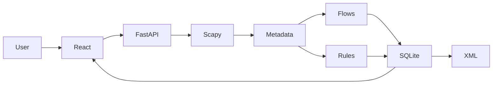
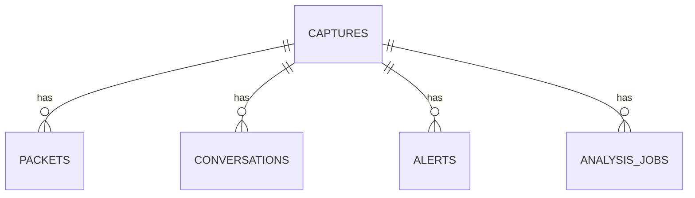

# NETSLEUTH — PCAP INTELLIGENCE & NETWORK THREAT ANALYSIS PLATFORM

**Academic project report**

Author: *Student name to be entered*

Institution / department / supervisor: *To be entered by the submitter*
Date: October 2026

## Abstract

NetSleuth is a local web application for converting packet captures into inspectable network evidence. Its primary academic modules are real PCAP to XML and PCAP to SQLite pipelines. Scapy parses offline PCAP and PCAPNG files, FastAPI exposes validated queries and exports, SQLite persists metadata and analysis, and a React dashboard displays packet, flow, protocol, and time views. A deterministic 45-packet synthetic capture demonstrates the system without live network access. Rule findings include actual counts and time windows and are presented as hypotheses rather than proof of compromise.

## Introduction, problem, and objectives

Packet capture files are rich but inconvenient to investigate manually. A student or analyst needs a repeatable way to inspect frames, search metadata, preserve results, and explain what triggered a suspicious traffic finding. The objectives are to parse real captures, normalize records into SQLite, serialize safe metadata into XML, compute meaningful summaries, and show results in an accessible local UI.

## Existing approach and limitations

General packet analyzers are powerful but may require expertise to produce a reusable database or purpose built report. Spreadsheet exports can lose protocol context. NetSleuth adds a compact educational workflow centered on persistent SQL analysis and XML conversion. It does not replace a full packet dissector or intrusion detection system.

## Proposed system and requirements

The system runs locally on Python 3.11+ and Node.js 20+ after installing pinned backend dependencies and the frontend lockfile. It needs disk space for uploaded captures and the SQLite database. Functional requirements include import, validation, packet paging and filters, conversations, rule findings, analytics, XML export, JSON report, historical capture selection, deletion, and database inspection. Nonfunctional requirements include safe upload limits, parameterized queries, bounded pagination, local only defaults, clear empty states, and honest interpretation of incomplete evidence.

## Architecture and data flow

The parser extracts timestamps, captured and reported wire lengths, Ethernet/IP/transport layer presence, addresses, ports, TCP flags, and DNS query names. The import service validates extension, size, and capture header; writes to a server generated filename; parses the capture; detects duplicate file hashes; and commits all result rows transactionally. Charts and tables consume API aggregates rather than embedded example values.

## Modules

**PCAP ingestion.** `backend/parser.py` iterates Scapy's reader and produces a metadata record per frame. Optional fields remain null. Invalid captures return a safe 422 error. The default upload cap is 100 MiB.

**PCAP to SQLite.** `backend/db.py` initializes schema version 1 with `captures`, `packets`, `conversations`, `alerts`, and `analysis_jobs`. Each child has a capture foreign key and cascade deletion. Packet time, protocol, and addresses are indexed. `executemany` uses placeholders and one transaction to avoid partial imports.

**PCAP to XML.** `backend/xml_export.py` yields a document header, capture attributes, and selected packet records incrementally. XML escaping uses `xml.sax.saxutils`. Absent values are omitted. The API supports a starting packet and bounded count. Raw payloads are omitted.

**Flow analysis.** TCP and UDP conversations use protocol plus unordered IP:port endpoints, with counts for each observed direction. ICMP and protocols without ports use their IP endpoints. Counts, bytes, first/last timestamps, and TCP flag summaries are stored.

**Detection.** Rules group traffic by source and 60 second buckets. A port sweep finding requires at least eight distinct destination endpoints with TCP SYN packets. Host fanout requires 12 destination IPs; DNS burst requires 30 queries. Thresholds are configurable in the detection function. Each alert has severity, evidence, time span, explanation, and defensive next step. These are heuristics; missing packets can change the interpretation.

**UI and reports.** Ten navigation views provide a responsive workstation. The overview and analytics views use live API values. Packet tables use server pagination. SQLite inspection is read only. Reports download JSON because PDF generation is not implemented.

## Database model

Capture IDs are random server generated hex identifiers; packet numbers are unique within a capture. `schema_version` records the installed schema. Duplicate imports are recognized using SHA-256 and file size.

## API design

OpenAPI is available at `/docs`. Routes include health (`GET /api/health`), upload (`POST /api/captures`), sample import (`POST /api/sample`), capture listing and detail, delete, jobs, paginated packets and packet detail, conversations, alerts, analytics, XML export, JSON report, and read only database statistics/rows. Query bounds are validated by FastAPI. Dynamic SQL identifiers come only from literal allowlists; values use placeholders.

## Testing methodology and observed results

The backend integration test creates a real 45-frame PCAP with Scapy, parses it, imports it through the API, queries SQLite rows, filters UDP packets, reparses a three-packet XML export with `ElementTree`, and requests analytics and a report. Additional tests cover PCAPNG, empty captures, invalid files, upload limits, SQL filter parameterization, XML escaping, missing layers, directional flow grouping, and a negative detection case. The most recent executed backend run had **7 passing tests and one dependency deprecation warning**. The frontend has two passing interaction tests and its TypeScript/Vite production build completed; Vite warned about a large JavaScript chunk. See `TEST_RESULTS.md` for exact commands and remaining checks. No throughput benchmark or browser end-to-end claim is made.

## Screenshots for submission

Capture the empty overview, sample import, populated overview, packet details, flow table, findings, analytics, XML export and resulting file, SQLite table counts, and report. Use `SCREENSHOT_CHECKLIST.md` to track evidence.

## Limitations and future enhancements

The import currently holds parsed metadata in memory until the transaction; very large captures need a streaming staging design. No authentication, live capture, payload inspection, TCP reassembly, IPv4 fragment reassembly, PDF report, or background job queue is implemented. The default local service must not be exposed publicly. Future work could add streaming imports, separate workers, flow timeout logic, role based access, and PDF export. The current rules do not establish connection success, malicious intent, or host compromise.

## Conclusion

NetSleuth implements the two required conversion modules as executable features, with a local investigation interface and reproducible sample. Its design keeps conclusions traceable to observed packet metadata and makes limitations visible to users.

## References

- [Scapy documentation](https://scapy.readthedocs.io/)
- [FastAPI documentation](https://fastapi.tiangolo.com/)
- [SQLite documentation](https://www.sqlite.org/docs.html)
- [Python XML documentation](https://docs.python.org/3/library/xml.html)
- [IETF RFC 9293: TCP](https://www.rfc-editor.org/rfc/rfc9293)
